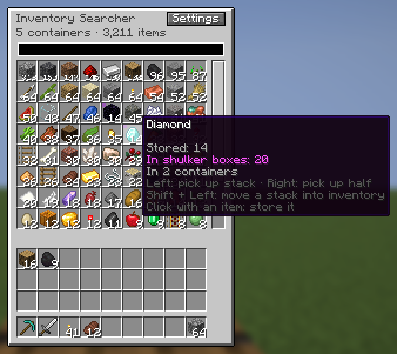
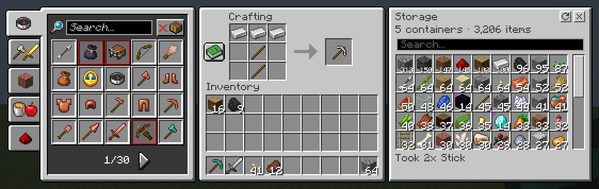

# Inventory Searcher

Client-side Fabric mod for Minecraft 26.3. One key scans every container in reach without opening its screen and lists all contents in a searchable terminal, like an ME system.



## Install

1. Install [Fabric Loader](https://fabricmc.net/use/) for Minecraft 26.3.
2. Download the [latest Inventory Searcher jar](https://github.com/Julian0021/inventory-searcher/releases/latest).
3. Put it into your `.minecraft/mods` folder and start the game.

No other mods needed, Fabric API is not required.

## Usage

| Input | Action |
|---|---|
| M (rebindable) | Scan and open the terminal |
| Left / right click item | Pick up a stack / half a stack |
| Shift + left click item | Move one stack into the inventory |
| Click grid while holding a stack | Store it in the nearest chest with room |
| Left / right click outside while holding a stack | Drop the stack / one item |
| Shift + left click own slot | Store that slot |
| Exclude key (unbound by default) while looking at a container | Exclude it from searching, or include it again |
| Ctrl + R / Esc, or the buttons at the top | Rescan / close |

Search by name, `@mod` or `#tooltip`. Items only stored inside shulker boxes are taken as a whole box. The last used container stays open until another one is needed.

### Crafting table

The chest button at the right edge of a crafting table scans the containers in reach and opens a storage panel next to it.



| Input | Action |
|---|---|
| Left / right click item in the panel | Pick up a stack / half a stack |
| Shift + left click item in the panel | Move a stack into the inventory |
| Click the panel while holding a stack | Store it in the nearest chest with room |
| Recipe in the recipe book | Takes what's missing out of the containers and places the recipe, shift for as many as possible |

The recipe book counts the stored items, so recipes made from them show up as craftable. A server keeps only one menu open, so the crafting table closes while the containers are opened and opens again afterwards. Items in the crafting grid go into the inventory first and back into the same slots, nothing drops. Where the screen is too narrow for everything side by side, the recipe book lies over the crafting table like on small screens.

## Settings

Via the gear button at the top of the terminal or Mod Menu, saved in `config/inventory-searcher.json`. Both keys are under *Inventory Searcher* in the vanilla controls.

- **Containers:** chest, trapped chest, barrel, shulker box, ender chest, furnace (more selectable)
- **Rotate / Swing:** off
- **Extra reach:** on, also opens containers up to one block beyond your reach (vanilla servers accept it, anticheat plugins may flag it)
- **Open delay / timeout:** 0 / 20 ticks
- **Clicks per tick:** 4
- **Shulker contents:** on
- **Sort:** count, name or mod
- **Excluded containers:** set the exclude key, and clear exclusions for the current world or everywhere. They are stored per world or server.

## Build

```sh
./gradlew build   # JDK 25, output in build/libs/
```

Only requires Fabric Loader. Licensed under GPL-3.0.
